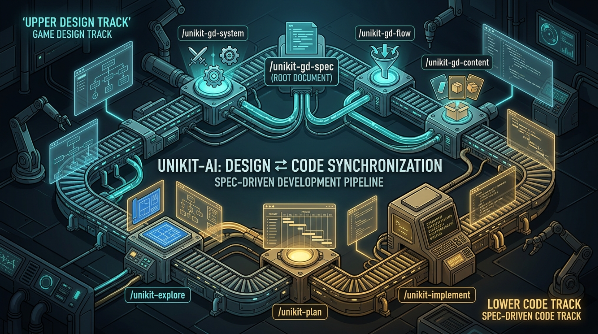

<p align="center">
  <a href="https://www.npmjs.com/package/unikit-ai">
    
  </a>
  <a href="https://github.com/NintendaDev/unikit-ai/actions/workflows/tests.yml">
    
  </a>
  <a href="https://github.com/NintendaDev/unikit-ai/blob/main/docs/skills.md">
    
  </a>
  <a href="https://unikit.nintenda.dev/">
    
  </a>
</p>

<p align="center">
  <a href="https://ko-fi.com/nintendadev">
    
  </a>
  <a href="https://boosty.to/nintendadev">
    
  </a>
</p>

<p align="center">
  
</p>

# UniKit AI

> **The AI Development Pipeline for Games: design, code, and the engine editor**

Building a game with AI usually breaks in the same place: the agent writes a class, and then stops. The design lives in someone's head, the scene lives in the editor, and neither is something a prompt can reach. UniKit AI closes that gap - it authors the **game design**, plans and writes the **code** against a memory of your engine and stack, and carries the same plan into the **engine editor** through the engine bridges - the engine's MCP servers and, for Unity, the Unity CLI. An engineered pipeline instead of vibe-coded prompts.

## Why UniKit AI?

- **Spec-driven development cycle** - explore the idea, plan, implement, review, verify, document. Each step reads the artifact the previous one wrote: no prompt engineering, no re-explaining the project every session, and a plan you can read and correct *before* a line is written. Predictable enough that a small model can execute a plan a large one made
- **Almost the whole cycle, not just the code** - design the game, write the code, work in the editor. One pipeline covers all three, and a single plan can mix code tasks with editor tasks
- **Engine bridges, used to the full and checked** - the agent gets real-time feedback from the running editor through the bridges you selected (the Unity CLI and the MCP servers of the engine): console, compilation errors, test runs, editor state. Every result is read back from the editor rather than taken from the bridge's response
- **Framework rules out of the box** - ready-made rules for engine modules and popular frameworks from the [official registry](https://github.com/NintendaDev/unikit-ai-rules). Plug in your own Git registry to carry a private rule library across projects, or generate fresh rules from your codebase on the fly
- **Dynamic memory** - one memory for all engine frameworks instead of a separate skill per library. Core rules are always loaded, stack rules are pulled in by task context - saving tokens and keeping the context window lean
- **Self-learning memory** - the agent turns bug fixes and code reviews into patches, then distills them into improved project rules. The system gets smarter with every fix

## Scope

UniKit AI covers three layers of game development:

| Layer             | What it covers                                                                                                |
| ----------------- | ------------------------------------------------------------------------------------------------------------- |
| **Game design**   | concept, pillars, systems, flows, content schemas - a machine-readable design that code plans read from       |
| **Game code**     | architecture, systems, tests, refactoring, review, documentation                                              |
| **Engine editor** | scenes, prefabs, UI, materials, animation, assets, project settings - planned as explicit tasks, executed through the engine bridges |

Editor work is a first-class part of a plan, not an afterthought: it is planned next to the code, carried out through the engine bridges and verified by reading the result back from the editor. See [Editor tasks](docs/plan-files.md#editor-tasks).

Art production, audio authoring, and store/build pipelines are **not** covered.

## Supported Engines

Each engine ships one or more bridges to the editor - MCP servers and, for Unity, the Unity CLI. You can select several; the order you set decides which is used first. A fresh Unity setup selects only Unity CLI by default; other bridges are opt-in. The versions are each vendor's own minimum. UniKit AI reads the Unity version from `ProjectSettings/ProjectVersion.txt` and looks for `unity` on your `PATH` to label a detected CLI in the wizard; detection does not change the selection. It does not check the minimum version of any other bridge, so check yours before accepting the defaults.

| Engine                 | Engine bridges (default order)                                                                                                                                                                                                                                                      |
| ---------------------- | ------------------------------------------------------------------------------------------------------------------------------------------------------------------------------------------------------------------------------------------------------------------------------------- |
| Unity                  | [Unity CLI](https://docs.unity.com/en-us/unity-cli) (Unity 6000.0+, with the `com.unity.pipeline` package) · [Unity Biome MCP](https://github.com/german-krasnikov/unity-biome-mcp) (Unity 6000.0+) · [Coplay Unity MCP](https://github.com/CoplayDev/unity-mcp) (Unity 2021.3 LTS+)                                                                                                                    |
| Godot 4 / Godot 4 .NET | [Fennara Godot AI](https://github.com/fennaraOfficial/fennara-godot-ai) - free (Godot 4.5+) · [GDAI Godot MCP](https://github.com/3ddelano/gdai-mcp-plugin-godot) - paid (Godot 4.1+) · [Coding-Solo Godot MCP](https://github.com/Coding-Solo/godot-mcp) - free (no declared minimum) |
| Unreal Engine 5        | [ChiR24 Unreal MCP](https://github.com/ChiR24/Unreal_mcp) (Unreal Engine 5.0+)                                                                                                                                                                                                          |

See [Configuration](docs/configuration.md#engine-bridge-rules-trees) for how UniKit AI works with each bridge.

---

## Supported Agents

| Agent             | Config Directory | MCP Support                     |
| ----------------- | ---------------- | ------------------------------- |
| Claude Code       | `.claude/`       | Yes (`.mcp.json`)               |
| Codex CLI         | `.codex/`        | Yes (`.codex/config.toml`)      |
| Cursor            | `.cursor/`       | Yes (`.cursor/mcp.json`)        |
| Qwen Code         | `.qwen/`         | Yes (`.qwen/settings.json`)     |
| OpenCode          | `.opencode/`     | Yes (`opencode.json`)           |
| Antigravity       | `.agents/`       | Yes (`.agents/mcp_config.json`) |
| Kimi Code         | `.kimi-code/`    | Yes (`.kimi-code/mcp.json`)     |
| Universal / Other | `.agents/`       | Yes (`.mcp.json`)               |

Select one or more during `unikit-ai init`. See [Agents](docs/agents.md) for agent-specific caveats.

---

## Installation & Quick Start

```bash
npm install -g unikit-ai    # install
unikit-ai self-update       # later: update the CLI itself from npm
unikit-ai update            # bring the project up to the installed CLI
```

`unikit-ai self-update` upgrades UniKit AI itself - the CLI on your machine - to the latest version on npm. `unikit-ai update` then brings the current project up to the version installed on this machine, reinstalling only what changed.

```bash
unikit-ai init              # in your game project directory
```

The wizard asks which AI agent you use and which game engine, configures the MCP servers, and installs the skills, subagents and engine templates.

**[Context7](https://github.com/upstash/context7)** is also recommended - the agent uses it for generating framework rules and deep research of libraries and APIs.

Then open your AI agent and start working. Give `/unikit` a couple of sentences about your game - what it is and how it plays:

```
/unikit A 2D top-down roguelike shooter for PC. The player clears
procedurally generated dungeon floors, collects weapons and upgrades
between runs, and fights a boss at the end of each floor.
```

Run without a description, `/unikit` asks for one. It then scans your game project, detects the full tech stack, asks targeted questions to fill in gaps, generates project description and architecture files, then bootstraps starter rules for every framework in your stack so the agent is ready to write idiomatic code from the first prompt.

### How It Works

```
  explore ──▶ plan ──▶ improve ──▶ implement ──▶ review ──▶ verify ──▶ commit
               │                       │                                 │
         design brief         code + editor tasks      fix ──▶ patch ────┤
                              through the engine bridges                 │
                                                                         │
                                     evolve ◀────────────────────────────┘
                           distill patches into rules
```

The development loop runs through exploration, planning, implementation, and review. Plans pull a design brief from the game design when there is one, execute code and editor work through the same pipeline, and bug fixes along the way generate patches that feed into the evolution step - distilling real project experience into permanent rules.

### Example Workflow

Say you need a character controller and want to settle its architecture before a line of code is written.

**1. Explore** - research the idea, analyze the codebase, find integration points:

```
/unikit-explore We need a character controller. The character must run,
jump, climb ladders and shoot weapons. Figure out which architecture to
use for the controller and which technologies fit it.
```

The agent produces a research document with diagrams, option comparisons, and architectural recommendations. Save it or feed it directly into the next step.

**2. Plan** - turn research into concrete tasks. Point the planner at the research:

```
/unikit-plan Use the latest research on the character controller
```

Run without arguments, `/unikit-plan` offers the most recent research itself. You can also plan straight from a task description, with no research behind it:

```
/unikit-plan Create an AI module for enemies based on a Behavior Tree
and a State Machine
```

A plan built on a research usually comes out better: the research has already compared the architectural options and found where the feature meets the existing code, so the plan settles those questions instead of guessing them. Plan directly when the task is small or the approach is already clear.

The plan carries both code tasks and, where the feature needs them, editor tasks - the player prefab and its collider, the animation states, the ladder trigger zones.

**3. Improve** - refine the plan (run 2-3 times for complex features):

```
/unikit-improve
```

**4. Implement** - execute the plan, code and editor tasks alike. Without arguments it runs every pending task of the plan:

```
/unikit-implement
```

Or go phase by phase and test in-game between the runs:

```
/unikit-implement Phases 1-3
```

`Phase 4` runs a single phase and `Tasks 2.1 2.3` runs individual tasks; the next run without arguments picks up what is still pending.

**No plan needed for small tasks** - `/unikit-execute` lets you vibe-code the classic way: describe the task, and the skill loads the whole harness - the project rules, the engine bridges - and makes the change, code and editor work alike, then checks that it compiles. Recommended for small tasks; a multi-step feature still deserves a plan:

```
/unikit-execute Let's rework the layout of the energy purchase window
to the new spec
```

**Fix bugs** - `/unikit-fix` takes a bug description or an error message, finds the cause and fixes it, and records a patch that later feeds the [self-learning](#self-learning) loop:

```
/unikit-fix Levels in the game take a long time to load.
Find the problem and the error.
```

**5. Review & Verify** (optional) - two different checks; run either, both, or skip them:

- **Review** looks at the code itself: does it follow the project rules, and is it good code?

```
/unikit-review
```

- **Verify** looks at the plan: does the code do what the plan asked, and was every task of the plan carried out correctly?

```
/unikit-verify
```

**6. Commit**:

```
/unikit-commit
```

**7. Pull request** (optional) - open the branch's PR, or print its text when the GitHub MCP is not set up:

```
/unikit-pr
```

**Lost?** Ask the navigator. `/unikit-help` takes a question in plain words and points you to the skill or pipeline that fits:

```
/unikit-help How do I work with the framework properly and how do I
write plans? Where should I start?
```

Run without a question, it starts a short diagnostic of where you are.

See the full [Development Workflow](docs/workflow.md) with diagram and decision table.

### Ultra Research and Ultra Plans

For complex, many-sided work there is an ultra mode. You turn it on by asking for it - the word `ultra`, or "ultra research" / "ultra plan" in your own words; the agent never picks it on its own because a task looks big.

- **Ultra research** goes deeper than an ordinary research: it keeps a log of the whole dialogue as you talk and saves extra artifacts next to the research - a C4 view of the architecture, decision records (ADRs), a dependency graph.
- **Ultra plan** writes a separate plan for every phase: the main plan keeps the checklist, and each phase gets its own file - a mini-plan with exact files, ordered edits, interfaces, acceptance criteria and checks. It suits complex, multi-system features, and a plan written by a strong model can be carried out later by a smaller one.

Run an ultra research, then build an ultra plan from it:

```
/unikit-explore ultra Design the save system: local saves, cloud sync
and migration of old save files between game versions
```

```
/unikit-plan ultra Use the latest research on the save system
```

`/unikit-implement` runs an ultra plan the same way as any other, all at once or phase by phase. See [Ultra bundle](docs/plan-files.md#ultra-bundle--a-manifest-plus-one-file-per-phase).

### Engine Bridge Routing

With several engine bridges selected, the agent tries them in the order of `.unikit/bridges.yaml`. Routing narrows that for one kind of work: describe the rule in your own words, and `/unikit-bridge-route` writes it as a row of `.unikit/bridge-routing.md` - `only` these bridges, these `first`, or `never` these:

```
/unikit-bridge-route run the tests only through unity-cli
```

```
/unikit-bridge-route never use coplay-unity-mcp for UI work
```

A rule decides only the steps of its own area; everything else keeps the order, and an instruction in your request still beats a rule. See [Bridge order, routing and the rule of a bridge](docs/configuration.md#bridge-order-routing-and-the-rule-of-a-bridge).

---

## Dynamic Memory and Remote Rules Registry

Every code task runs through a two-tier knowledge base: **core rules** are always loaded (code style, design principles, performance, testing), **stack rules** are loaded only when the task needs them (DI, async, reactive, UI, etc.). Rules come from the **[official remote registry](https://github.com/NintendaDev/unikit-ai-rules)**, versioned independently of the npm package, and you can connect your own private registry to carry your team's rule library across projects.

→ [Dynamic Memory](docs/dynamic-memory.md) · [Rules Registry](docs/rules-registry.md)

---

## Self-Learning

Every bug fix and code review creates a patch - a record of what went wrong and how it was fixed. When patches accumulate, `/unikit-evolve` analyzes them and distills patterns into project rules.

```
  bug found ──▶ /unikit-fix ──▶ patch created ──▶ /unikit-evolve ──▶ new rule
                                                                        │
                                                          next session uses it
```

The agent doesn't repeat the same mistakes: the more you fix and evolve, the smarter the framework becomes for your specific project.

→ [Memory & Skill Evolution](docs/evolve.md)

---

## Game Design

Beyond code, UniKit AI helps author the game design itself, so that planning starts from a written design instead of a prompt:

- **Ideate and research** - brainstorm a concept, check the market and references
- **Author** - the one-page game overview, then systems, player flows and content schemas
- **Balance** - tune numbers in a measured loop: one checkpoint at a time, a plan, a report, the next decision
- **Experiments** - test a hypothesis about the game on real players with the smallest prototype: ideas, a specification a planner can build from, playtest feedback, an honest evaluation
- **Review and verify** - a qualitative review and a consistency check of the whole design
- **Start from existing code** - reconstruct design facts from a project that has no design document yet
- **Genre starters** - a bundled catalog of genre profiles seeds a new design
- **Read it as a document** - render the design into human-readable docs

The design feeds code plans, and code never edits it, with one exception: once `/unikit-verify` confirms a feature is done, the design is marked as implemented.

→ [Game-Design Module](docs/gamedesign.md)

UniKit AI works alongside any other AI framework - it uses its own config directory and never touches standard agent files like CLAUDE.md or .cursorrules.

---

## Documentation

| Guide                                           | Description                                              |
| ----------------------------------------------- | -------------------------------------------------------- |
| [Getting Started](docs/getting-started.md)      | What is UniKit AI, CLI commands, first project           |
| [Help Navigator](docs/skills.md)                | Not sure which skill to use? Start here                  |
| [Agents](docs/agents.md)                        | Supported AI agents and their known limitations          |
| [Best Practices](docs/best-practices.md)        | Practical tips for working with the agent                |
| [Development Workflow](docs/workflow.md)        | Workflow diagram, skill pipeline, spec-driven approach   |
| [Skills Reference](docs/skills.md)              | All 39 skills - 26 code-pipeline + 13 game-design        |
| [Subagents](docs/subagents.md)                  | Coordinators, workers and sidecars                       |
| [Plan Files](docs/plan-files.md)                | Plans, editor tasks, patches                             |
| [Game-Design Module](docs/gamedesign.md)        | Game design authoring and genre profiles                 |
| [Dynamic Memory](docs/dynamic-memory.md)        | Core and stack rules, the memory pipeline                |
| [Memory & Skill Evolution](docs/evolve.md)      | How fix patches turn into rules                          |
| [Configuration](docs/configuration.md)          | Project config, MCP servers, project structure           |
| [Rules Registry](docs/rules-registry.md)        | Remote rules registry and its CLI commands               |
| [Extensions](docs/extensions.md)                | Third-party skills, injections, MCP servers              |

---

## Educational materials on YouTube (Russian)

🎞 [Как мы пишем игру на Unity полностью с AI](https://youtu.be/vAjTv0E4slo)

🎞 [От установки в проект Unity до первого AI коммита](https://youtu.be/YPwjqy6Uc_M)

🎞 [Как заставить ИИ-агента перестать угадывать архитектуру для игры в Unity](https://youtu.be/i0pY65_gNoI)

🎞 [От ИИ-плана до закоммиченной фичи на Unity](https://youtu.be/IFdmcxNRPZE)

🎞 [Память AI-агента под свой Unity проект](https://youtu.be/gAXAx7RNgC0)

---

## Community

- [Telegram Community](https://t.me/nintendadev_community) - chat with other users, share your rules, get quick help
- [Github Discussions](https://github.com/NintendaDev/unikit-ai/discussions) - deeper technical discussions and framework proposals
- [Github Issues](https://github.com/NintendaDev/unikit-ai/issues) - bug reports and feature requests

## Links

- [Author Official Site](https://nintenda.dev) - personal website and hub for all author's projects
- [Author Telegram Channel](https://t.me/nintendadev_channel) - follow updates, roadmap previews, and dev blog posts
- [Unity](https://unity.com) | [Godot](https://godotengine.org) | [Unreal Engine](https://www.unrealengine.com) - Supported game engines
- [Context7](https://github.com/upstash/context7) - library documentation MCP server
- [Claude Code](https://claude.ai/code) - Anthropic's AI coding agent
- [Qwen Code](https://github.com/QwenLM/qwen-code) - Alibaba's AI coding agent
- [OpenCode](https://opencode.ai) - Open-source AI coding agent

## License

MIT License. See [LICENSE](LICENSE) for details.
